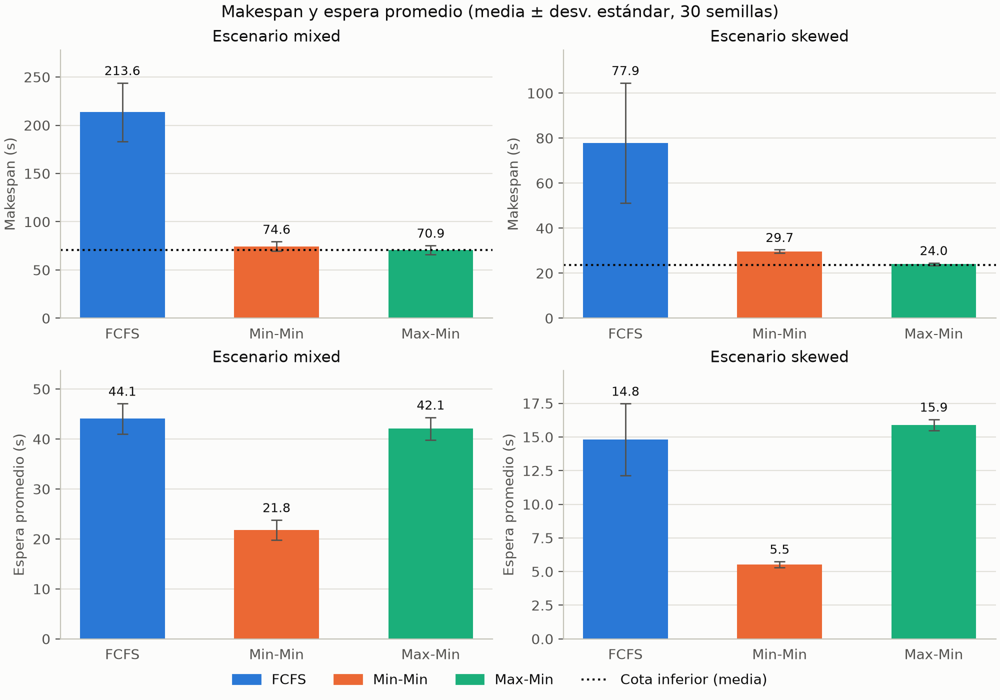
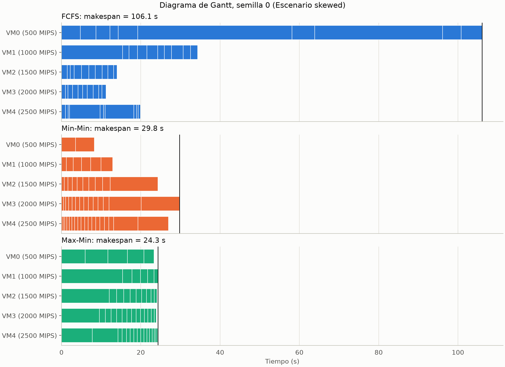
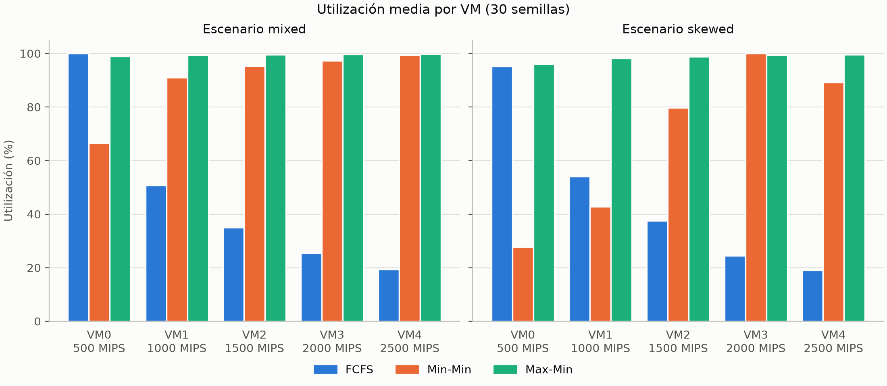

# Planificación (scheduling) en Cloud Computing: FCFS, Min-Min y Max-Min

Laboratorio de la Semana 12 del curso Cloud Computing (Ingeniería de Software, UTP).

## Objetivo

Simular y comparar **FCFS** y **Min-Min** con **50 tareas** de distintos tamaños y **5 VMs** de
distintas capacidades, medir **makespan** y **tiempo de espera**, graficar los resultados y responder:

1. ¿Cuál algoritmo terminó antes?
2. ¿Cuál aprovechó mejor la CPU?

Se añade **Max-Min** como contraste, dos escenarios de carga, 30 semillas por escenario y una
validación con un caso calculado a mano.

## Cómo ejecutar

Requiere Python 3.11 o superior. En Windows:

```bash
python -m venv .venv
```

```bash
.venv\Scripts\activate
```

```bash
pip install -r requirements.txt
```

```bash
pytest -q
```

```bash
python run_all.py
```

En Linux o macOS, el entorno se activa con `source .venv/bin/activate`.

`run_all.py` genera `data/`, `results/` y `figures/`. Para revisar tablas y figuras de forma interactiva,
abre `notebooks/analysis.ipynb`, que lee `results/`.

### Caso de la guía de evaluación

La guía de evaluación práctica plantea un caso de 8 trabajos en 3 VMs iguales. Este comando imprime, para
cada estrategia, los trabajos de cada VM, su uso, el makespan, la espera y el tiempo ocioso:

```bash
python demo_caso_guia.py
```

No usa recursos cloud reales: las VMs son un modelo que se calcula en el equipo local. Con VMs iguales,
Min-Min equivale a SJF con la VM que se libera primero, y Max-Min equivale a LPT.

## Modelo

- **Tareas:** longitud en MI, con `arrival = 0` (planificación estática por lotes).
- **VMs:** 500, 1000, 1500, 2000 y 2500 MIPS, fijas en todos los experimentos.
- **Ejecución:** cada VM corre una tarea a la vez, sin expropiación. `ETC = MI / MIPS`.
- **FCFS cíclico:** la tarea *i* va a la VM `i % 5`, sin mirar su velocidad.
- **Min-Min y Max-Min:** calculan el tiempo de finalización mínimo de cada tarea pendiente y atienden la
  tarea con el menor (Min-Min) o el mayor (Max-Min) de esos mínimos.
- **Escenarios:** `mixed` tiene MI ~ U(1000, 20000). `skewed` tiene 45 tareas ~ U(1000, 3000) y
  5 tareas ~ U(15000, 20000).
- **Diseño pareado:** en cada escenario y semilla, los tres algoritmos reciben el mismo dataset.

Con `arrival = 0`, la espera de una tarea es igual a su instante de inicio. Es una consecuencia del
modelo, no un error.

## Resultados

Media ± desviación estándar en 30 semillas. Datos completos en `results/summary.csv`.

| Escenario | Algoritmo | Makespan (s) | Makespan / cota | Espera prom. (s) | Espera máx. (s) | ARUR | DI |
|---|---|---|---|---|---|---|---|
| mixed | FCFS | 213.59 ± 30.43 | 3.03 | 44.06 ± 3.06 | 191.07 | 0.461 ± 0.052 | 1.788 |
| mixed | Min-Min | 74.56 ± 4.92 | 1.06 | 21.80 ± 2.02 | 66.33 | 0.899 ± 0.019 | 0.373 |
| mixed | Max-Min | 70.89 ± 4.61 | 1.00 | 42.07 ± 2.29 | 69.95 | 0.995 ± 0.003 | 0.013 |
| skewed | FCFS | 77.91 ± 26.66 | 3.28 | 14.82 ± 2.67 | 69.54 | 0.461 ± 0.105 | 1.988 |
| skewed | Min-Min | 29.71 ± 0.74 | 1.25 | 5.53 ± 0.22 | 20.09 | 0.679 ± 0.007 | 1.064 |
| skewed | Max-Min | 23.98 ± 0.62 | 1.01 | 15.89 ± 0.42 | 23.50 | 0.984 ± 0.004 | 0.040 |

Mejora respecto a FCFS (compara medias; positivo es mejor) y victorias. Una victoria es tener el menor
valor de los tres algoritmos en una semilla.

| Escenario | Algoritmo | % mejora makespan | % mejora espera | Victorias makespan | Victorias espera |
|---|---|---|---|---|---|
| mixed | Min-Min | 65.09 | 50.51 | 0/30 | 30/30 |
| mixed | Max-Min | 66.81 | 4.51 | 30/30 | 0/30 |
| skewed | Min-Min | 61.87 | 62.70 | 0/30 | 30/30 |
| skewed | Max-Min | 69.22 | −7.23 | 30/30 | 0/30 |

FCFS no gana ninguna semilla en ninguna de las dos métricas.

**Wilcoxon pareado** (`results/wilcoxon.csv`). Diferencia media de A − B en segundos:

| Escenario | Comparación | Makespan | Espera promedio |
|---|---|---|---|
| mixed | Min-Min − Max-Min | +3.67 | −20.27 |
| mixed | Min-Min − FCFS | −139.03 | −22.25 |
| skewed | Min-Min − Max-Min | +5.72 | −10.36 |
| skewed | Min-Min − FCFS | −48.20 | −9.29 |

En las 8 pruebas `p = 1.86e-09`. Es el mínimo posible con 30 pares y aparece porque todas las semillas
van en la misma dirección, por lo que la magnitud del efecto se lee en la diferencia media. Los p-valores
no están corregidos por comparaciones múltiples.

## Figuras clave

**Makespan y espera promedio.** La línea punteada es la cota inferior media del makespan.



**Gantt del escenario `skewed`, semilla 0.** Todos los paneles comparten el eje X.



**Utilización media por VM.**



También están disponibles `figures/gantt_mixed.png` y `figures/boxplot_makespan.png`.

## Respuestas a las preguntas de la guía

### 1. ¿Cuál algoritmo terminó antes?

**Entre los dos que pide la guía, Min-Min.** Su makespan fue menor que el de FCFS en las 30 semillas de
ambos escenarios: 74.56 s frente a 213.59 s en `mixed` (−65.09 %) y 29.71 s frente a 77.91 s en `skewed`
(−61.87 %).

**Con Max-Min incluido, Max-Min.** Ganó en las 30 semillas de ambos escenarios y quedó muy cerca de la
cota inferior (1.00 veces en `mixed` y 1.01 en `skewed`). Su ventaja sobre Min-Min fue de 4.93 % en
`mixed` y de 19.27 % en `skewed`.

### 2. ¿Cuál aprovechó mejor la CPU?

**Entre los dos que pide la guía, Min-Min.** Su ARUR fue de 0.899 frente a 0.461 de FCFS en `mixed`, y de
0.679 frente a 0.461 en `skewed`. Superó a FCFS en 30 de 30 semillas en `mixed` y en 29 de 30 en `skewed`.

**Con Max-Min incluido, Max-Min.** Obtuvo el mayor ARUR (0.995 y 0.984) y el menor desbalance (DI de 0.013
y 0.040) en las 30 semillas de cada escenario.

**Matiz sobre ARUR:** esta métrica mide qué fracción del tiempo está ocupada cada VM, pero no distingue una
VM lenta de una rápida. Por VM, el tiempo ocupado medio (`ARUR × makespan`) fue:

| Escenario | FCFS | Min-Min | Max-Min |
|---|---|---|---|
| mixed | 97.16 s | 67.03 s | 70.51 s |
| skewed | 33.38 s | 20.17 s | 23.60 s |

Min-Min resolvió el mismo trabajo con menos VM-segundos que Max-Min porque usa menos las VMs lentas: VM0
quedó al 66.6 % en `mixed` y al 27.8 % en `skewed`. Max-Min ocupa todas las VMs de forma pareja, también
las lentas. FCFS es el peor en ambos sentidos: consume más VM-segundos y aun así tiene el menor ARUR.

## Contraste de las hipótesis

| Hipótesis | Resultado |
|---|---|
| Min-Min da menor espera promedio | **Se cumple.** Ganó 30/30 semillas en ambos escenarios. |
| Max-Min da menor makespan y mejor balance | **Se cumple.** Ganó 30/30 semillas en makespan y en DI, en ambos escenarios. |
| La ventaja de Max-Min crece en `skewed` | **Se cumple.** La ventaja en makespan sobre Min-Min pasa de 4.93 % a 19.27 %. |
| FCFS cíclico sufre por ignorar la velocidad | **Se cumple en makespan, con un matiz en la espera.** Ver abajo. |

FCFS quedó a más de 3 veces la cota inferior en promedio. VM0, la más lenta, fue la última en terminar en
30 de 30 semillas en `mixed` y en 24 de 30 en `skewed`. Sin embargo, en espera promedio FCFS no fue siempre
el peor: en `skewed` tuvo menos espera media que Max-Min (14.82 s frente a 15.89 s) y le ganó en 21 de 30
semillas. Max-Min atiende primero las tareas largas y hace esperar a las 45 cortas. Esta comparación es
descriptiva, porque Max-Min vs FCFS no forma parte de `wilcoxon.csv`.

**El compromiso observado:** ningún algoritmo ganó en todo. Max-Min termina antes y equilibra mejor; Min-Min
hace esperar mucho menos a las tareas (la mitad en `mixed` y un tercio en `skewed` respecto a Max-Min) a
cambio de un makespan algo mayor.

## Alcance y limitaciones

Es una simulación estática por lotes: todas las tareas llegan en `t = 0`, los ETC son deterministas y no
se modela la red, los costos ni la energía. Los resultados aplican a este modelo y a estas VMs, y no
deben extrapolarse a un entorno de producción sin más pruebas.

## Validación

- `tests/test_hand_case.py`: caso de 4 tareas × 2 VMs con valores verificados a mano, incluido el empate
  del paso 3 de Min-Min.
- `tests/test_invariants.py`: cada tarea se asigna una vez, no hay solapamientos, `finish − start = ETC`,
  el makespan respeta la cota inferior, la utilización está entre 0 y 1, y los resultados son deterministas.
- `tests/test_guide_case.py`: valores exactos del caso de 8 trabajos de la guía de evaluación.

## Estructura

```
├── run_all.py              # genera data/, results/ y figures/
├── demo_caso_guia.py       # muestra el caso de 8 trabajos de la guía de evaluación
├── pytest.ini              # hace visible src/ para las pruebas
├── src/scheduling/
│   ├── models.py           # Task, VM, Assignment
│   ├── datasets.py         # generación de tareas y VMs fijas
│   ├── schedulers.py       # FCFS, MinMin, MaxMin
│   ├── metrics.py          # métricas como funciones puras
│   ├── experiment.py       # experimentos, resumen y Wilcoxon
│   ├── plots.py            # figuras, compartidas con el notebook
│   └── guide_case.py       # caso de la guía de evaluación
├── tests/
├── data/                   # tasks_<escenario>_seed<N>.csv, vms.csv
├── results/                # metrics.csv, summary.csv, wilcoxon.csv, assignments_*.csv
├── figures/                # PNG a 200 dpi
└── notebooks/analysis.ipynb
```
